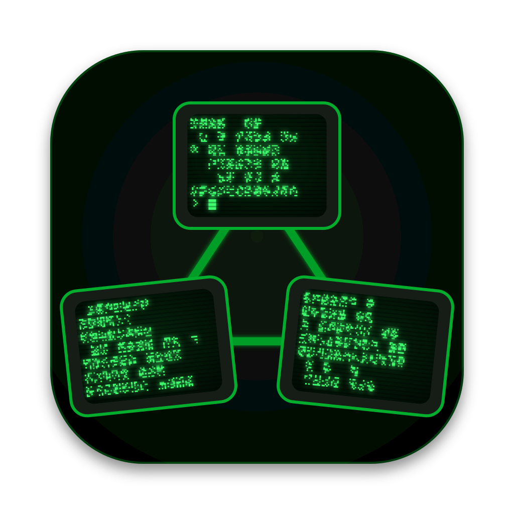

<h1 align="center">
  
  Terminal Remote Control
</h1>

<p align="center">
  <a href="https://github.com/renatorroliveira/terminal-remote-control/actions/workflows/ci.yml"></a>
</p>

An accessible desktop terminal manager whose sessions outlive the app, the network and the client computer.

> **Status: early preview.** Version 0.1 is the first milestone of Epic 1: a macOS app that adds Linux hosts over
> SSH, installs its daemon on them, and runs and switches terminal sessions there, with VoiceOver, Zoom and
> keyboard support. The [E1 implementation plan](docs/plans/epic-01-implementation-plan.md) tracks the rest of the
> epic.

## Why

Developers keep long-running work in terminals: builds, log tails, REPLs, remote shells. Today they choose
between desktop terminals, whose shells die when the app quits, and multiplexers such as tmux, which need setup on
every host and draw their UI as characters that screen readers read as noise. Neither works well with assistive
technology.

Terminal Remote Control combines persistent local and remote sessions, zero per-host setup and first-class support for
screen readers, magnifiers, voice control and keyboard-only use.

## Features

Planned for the first full release (P0), delivered in seven epics, then a general-availability release (E8):

- **Accessible first.** WCAG 2.2 AA, with native integration for VoiceOver, JAWS, NVDA, Narrator, Orca, screen
  magnifiers, Speak Selection and voice control. Terminal text is real, selectable text that the operating system
  can read, and the OS tracks focus and the text cursor. The default Midnight theme is high contrast (AAA), and the
  app embeds Atkinson Hyperlegible Next and Intel One Mono.
- **Sessions that never die.** A per-user daemon on each host owns the sessions. Quitting or crashing the app,
  losing the network or rebooting the client ends no session. After a host reboot, the daemon respawns each
  session's shell and restores its scrollback, without ever re-running commands.
- **Zero remote setup.** Any Linux or macOS host you reach with `ssh` and a key works. The app installs its daemon
  over SSH for your user: no sudo, no packages and no internet access on the host.
- **One place.** Every session, local and remote, in one sidebar grouped by host, with live state.
- **Secure by default.** No network listener anywhere, not even on loopback. SSH is the only door to a remote host,
  authentication is key-based only, and terminal output is treated as untrusted.

| Epic | Delivers                                                                         |
| ---- | -------------------------------------------------------------------------------- |
| E1   | Accessible macOS app running sessions on Linux hosts                             |
| E2   | Sessions that outlive the app and the network; shared sessions                   |
| E3   | Sessions that survive a host reboot; daemon management                           |
| E4   | Command-aware terminal: jump between commands, background events                 |
| E5   | Local sessions on the Mac, and macOS hosts                                       |
| E6   | Windows desktop app                                                              |
| E7   | Linux desktop app                                                                |
| E8   | GA release 1.0.0: downloads site, provenance, signed packages, automatic updates |

## How it works

```
Desktop app (Electron)                        Host
┌───────────────────────────────┐             ┌─────────────────────────────────┐
│ renderer: React UI, xterm.js, │             │ trcd bridge: one per connection │
│   accessible text surface     │   ssh exec  │ trcd core: one per user         │
│ connection host: one ssh      │ ──────────► │ trcd holder: one per session    │
│   process per host            │   channel   │   (PTY, shell, scrollback)      │
└───────────────────────────────┘             └─────────────────────────────────┘
```

- The **desktop app** is an Electron app built the way VS Code is. It renders sessions and relays input, and holds
  no session state that a daemon cannot recover.
- The **daemon**, `trcd`, is a small static Rust binary: one per user per host, the same binary locally and
  remotely. It owns the PTYs, supervises processes and keeps scrollback.
- The app reaches remote daemons through the system OpenSSH client, honoring your SSH config and agent. One exec
  channel per host carries every session, so it works even when SSH forwarding is disabled.

## Get started

1. Download the dmg for your Mac (Apple silicon or Intel) from the
   [latest release](https://github.com/renatorroliveira/terminal-remote-control/releases/latest) and drag the app to
   Applications. 0.x releases are alpha, experimental builds, ad-hoc signed until 1.0.0, so the first launch needs
   Open Anyway in System Settings, Privacy & Security.
2. Make sure `ssh <host>` works in Terminal with a key in your SSH agent and no password.
3. Open the app, type the host in the Hosts field (an SSH alias or `user@host:port`) and choose Add host.
4. Choose the + next to the host to start a session.

The app keeps its settings in `~/.trc` (`config.json` and `hosts.json`); set `TRC_HOME` to use another folder. On
each host, it installs its daemon under `~/.trc` for your user. The [user guide](USER_GUIDE.md) covers everything
the app does today.

## Documentation

- [User guide](USER_GUIDE.md): installing, adding hosts, sessions, the terminal, settings and troubleshooting.

- [Product requirements (PRD)](docs/PRD.md): goals, global accessibility, security and performance requirements,
  and every epic's user stories.
- [Tech stack](docs/TECH_STACK.md): the chosen languages, libraries and tools, and the decision log.
- [E1 implementation plan](docs/plans/epic-01-implementation-plan.md): the stories that deliver Epic 1 and their
  status.

## Development

### Prerequisites

- macOS on Apple silicon (E1 builds the macOS app and Linux daemons).
- Node.js 24 and pnpm 12 (`corepack enable pnpm`).
- Rust through rustup; `rust-toolchain.toml` pins the version and the musl targets.
- `cargo install --locked cargo-nextest cargo-zigbuild`, Zig 0.17 and minisign (`brew install zig minisign`), then
  `tools/fetch-libghostty.sh` once to download and verify libghostty-vt.
- For the Linux test hosts: colima and the docker CLI (`brew install colima docker`).
- For the accessibility probe: Xcode command-line tools (Swift), and the Accessibility permission for your terminal.

### Commands

| Command                           | What it does                                                                               |
| --------------------------------- | ------------------------------------------------------------------------------------------ |
| `pnpm install`                    | Installs dependencies and the git hooks                                                    |
| `pnpm check`                      | The full local gate: Prettier, Biome, document IDs, `tsc`, Vitest, Rust fmt/clippy/nextest |
| `pnpm --filter @trc/desktop i18n` | Extracts and precompiles the UI messages after a string changes                            |
| `pnpm test`                       | Vitest unit tests (Node) and component tests (Chromium, with axe)                          |
| `pnpm test:integration`           | Tests against the Linux test hosts (start them with `tools/test-hosts/up.sh`)              |
| `pnpm build:daemon`               | Builds the Linux daemons into `apps/desktop/resources/daemon` with their manifest          |
| `pnpm test:daemon`                | The daemon's musl tests in Ubuntu, Alpine and Rocky containers (part of the above)         |
| `pnpm test:e2e`                   | Builds a test build of the app and runs the Playwright Electron tests                      |
| `pnpm test:nfr`                   | Measures the NFR targets against the test hosts; see `docs/verification/E1-nfr.md`         |
| `pnpm test:ax`                    | Builds `tools/ax-probe` and a test build, then runs the macOS accessibility-tree tests     |
| `pnpm --filter @trc/desktop dev`  | Runs the app with hot reload                                                               |
| `pnpm icons`                      | Renders the app icons in `apps/desktop/resources/icons` from `tools/icons`                 |
| `pnpm dist`                       | Builds the ad-hoc signed arm64 and x64 dmg and zip into `apps/desktop/dist`                |
| `pnpm verify:artifact <app>`      | Checks a packaged app before it ships (launches it in the background)                      |
| `pnpm release <level>`            | Starts the release workflow on GitHub; see below                                           |
| `cargo nextest run`               | Rust tests                                                                                 |

Single tests: `pnpm exec vitest run <file> -t <name>` and `cargo nextest run <name>`.

### Releases

Versions follow [semver](https://semver.org/). Between releases, `main` carries the next minor version with a
`-dev` suffix (`0.2.0-dev`). Releases run entirely in GitHub Actions (`.github/workflows/release.yml`): start one
from the Actions tab's **Run workflow** button, or with `gh` logged in:

```sh
pnpm release minor --dry-run   # builds and checks everything, pushes and publishes nothing
pnpm release minor             # or patch, or major
```

The workflow computes the version from the last `v*` tag and commits it, runs CI on that commit, builds both Linux
daemons on Ubuntu and the arm64 and x64 dmg and zip on macOS, then checks each package on its own architecture's
runner with `pnpm verify:artifact` on the app in both the zip and the dmg (signature, fuses, no test seam, the
daemons against their manifest, and no listening sockets). Only when all of that passes does it tag and push the
release commit, publish the [GitHub Release](https://github.com/renatorroliveira/terminal-remote-control/releases)
`TRC v<version>` with the notes, the four packages and `SHA256SUMS.txt` (a draft until every file is up), and push
the next `-dev` version. If `main` moved during the run, the push is refused and nothing is published. A version
below the one `main` carries is refused too. If the publish job fails part way, re-run it from the run's page: it
skips each step that is already done (the tag, the release, the `-dev` version).

CI builds the project and runs the unit tests on every push to `main` and every pull request. The integration, e2e
and accessibility-tree suites need the local test hosts and macOS permissions, so they run locally.

## Contributing

Commits follow [Conventional Commits](https://www.conventionalcommits.org/) and reference the PRD requirement IDs
they implement (for example `feat(daemon): ... (US-1.9)`).

## License

[MIT](LICENSE)
